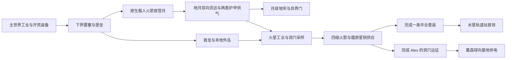

# 远征 1.21.1 开发计划

本线运行 Minecraft 1.21.1、NeoForge 21.1.267 和 Java 21。测试包版本使用 `1.21.1-test.N`。

[1.20.1 正式线开发计划与 ATM 之星路线](https://github.com/Eldershi/mechanical-expedition/blob/main/docs/roadmap.md)

## 进度主线

| 里程碑 | 成果与前置 | 验收 | 状态 |
| --- | --- | --- | --- |
| 原版下界与末地 | 下界取得烈焰棒、热加工和合金材料；首龙与登月并行，火星前完成；龙后外岛取得鞘翅、潜影壳和灵质空气 | 两条护甲线均可获得第一批材料，首龙可用前段装备完成 | 进度衔接待实现 |
| 原生航天 | 主世界工业造四级火箭，载人首次登月沿用 Ad Astra | 四级制造集成与原生地月往返 | 已在测试环境验证 |
| 地月物流 | 登月后以戴斯材料制造卫星站、发射台、电梯和空投炮 | 三批成功交付、双向各至少一批，重启和满载下不重复交付 | 当前开发目标 |
| 月面异界门 | 从轨道定位月球地牢并实地调查，配合稳定货运取得首次访问 | 进入已有异界并成功撤离，原下界入口按个人到达解锁 | 当前开发目标 |
| 两套太空护甲 | 机素防护用 Ad Astra 氧气；机巧新生用专用自然空气格 | 同一补给点，两套都能在真空作战，缺气及卸甲正确失效 | 当前开发目标 |
| 火星、霜原星和铜 | 扩建火星工业，以四级火箭到 Glacio 取得原生铜矿 | 地球基地持续收到霜原铜，停机后可续运 | 待实现 |
| Alex 的洞穴与戴森球 | 前段采样支撑高阶制造，完整洞穴远征开放戴森球并网 | 完成实地目标，并连续向基地负载供电 | 待实现 |
| 毕业装备与轨道站 | 霜原铜、火星和洞穴材料完成一条装备路线；水星可提早侦察 | 水星轨道能生成空间站、召唤构造体、撤离和重战，两套甲均可通关 | 待实现 |

## 装备与难度

| 路线 | 当前基线 | 毕业设计 |
| --- | --- | --- |
| 机素防护 | 链板 15 甲、16 韧；11 块合金插板的高甲配装可达 31 甲、20 韧 | 下界耐热、月面轻量插板、火星承力关节、霜原铜执行器 |
| 机巧新生 | 基础气密四件 24 甲、24 韧；四个持续供气的抗性模块合计最多额外减免 80% 的适用伤害 | 主世界试炼、下界锻造、末地推进气体、火星稳压与洞穴密封工艺 |

莱特兰恶意测试目标为主世界常怪 Lv.0–25、下界 Lv.20–55、末地常怪 Lv.35–75、月面 Lv.20–40、火星 Lv.40–70、霜原星 Lv.60–95、异界 Lv.85–125。首龙 Lv.55–75、末影守卫 Lv.80–100、湮灭构造体 Lv.140–165，毕业后的自选重战 Lv.200–250。保留首领原招式，以实战的输出窗口、气量、重试与撤离校准。轨道首访和气闸附近限制强制位移与破魔组合。

## 维护与发布

独立测试客户端、服务端和游戏存档。提交前验证当前配套清单和源码，实装验收包括多人权限、保存重启、老存档副本和干净测试世界。每个可用测试版本绑定 Git 提交和 `v1.21.1-test.N` 标签。
