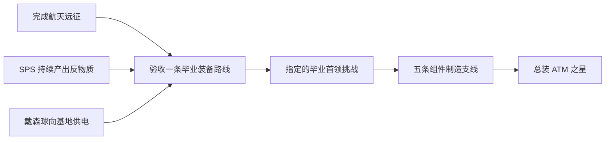

# 远征 1.20.1 开发计划

本线维护 Minecraft 1.20.1、Forge 47.4.10 和 Java 17，开发与发布使用 `main`。

[1.21.1 测试线开发计划](https://github.com/Eldershi/mechanical-expedition/blob/migration/1.21.1-neoforge/docs/roadmap.md)

## 毕业路线

| 里程碑 | 前置与成果 | 验收 | 状态 |
| --- | --- | --- | --- |
| 航天远征 | 主世界工业制造火箭，远征月球和后续行星，采回支持晚期工业的材料 | 生存航行、采集、返航与可重复补给均成立 | 已有航天制造和任务，毕业验收待设计 |
| 反物质产线 | 晚期电子、核化学供钋和持续供电汇合到 SPS | 完整 SPS 持续产出实际反物质，记录两个以上生产批次 | 已有生产机制和任务，毕业验收待设计 |
| 戴森球并网 | 建造戴森球与接收设施 | 实测接收端向基地负载持续送电 | 已集成 Dyson Cube Project，毕业验收待设计 |
| 毕业装备 | 完成航天、SPS 与并网后，从可取得的毕业构筑中任选一条 | 检查成套装备、持续供能或维修、机动和生存能力 | 数值和配装已有研究，任务待设计 |
| 毕业首领 | 装备验收开放指定毕业挑战，掉落进入部件生产 | 首领奖励来源明确，队伍可再次挑战并补齐材料 | 首领名单、挑战判定与掉落待设计 |
| 五件终局组件 | 将狩猎素材和工业半成品分别送入五条支线 | 首次制造可达、失败可重试、组件可重复生产 | 构思已定，实施待排期 |
| ATM 之星 | 五件成品汇合，完成机械总装和能量稳定 | 实际取出成品，首次任务奖励无一次性材料循环 | 总装待实现 |

航空和宇航构件可以与核工业并行。任务拆开反物质构件和 SPS 产物，前者使用钋丸、钚丸和量子零件，后者是真正的反物质。已有晚期航空、计算与能源设备见任务书「航空与宇航总览」及「计算与能源」。

## 五件组件

| 组件 | 制造与挑战方向 | 本线依赖 |
| --- | --- | --- |
| 共生之心 | 加工魂胚，将狩猎素材做成宴席并完成赋生 | 现有料理工艺可作基础，首领料理、魂质接续和献礼判定待核对 |
| 应变之心 | 制造精密载体，带着战斗装备完成反馈调律 | 现有电子加工和莱特兰恶意可验证，反制流程及素材待定 |
| 归航之心 | 制作导航胚，携带它完成三界实地测绘后返航 | 主世界、下界、末地的交通与样本可用，航点与回程判定待定 |
| 核火之心 | 以晚期核工业物料封装半成品，经受可重复的核火试炼 | 核化学与 SPS 可作为工艺基础，试炼、失败回收及批量路径待定 |
| 折界之心 | 以奇点、耦合器和航标完成放出、辨认与回收 | 现有 AE2 路线可核对，跨界机制和挑战掉落待定 |

首领掉落用于制造，毕业配装和校准工具可继续使用。后续设计分别验证每条支线的第一份素材、重战补给与重复制造。1.21.1 的配方和候选附属模组须先核对 Forge 1.20.1 兼容性。

## 维护与发布

正式客户端及服务端使用本线配套清单。修改任务、脚本或配方后，以实际正式客户端及其配套验证实例核对注册、配方和任务可达性。发包前检查清单、加载器及文件哈希，使用 `main` 的正式构建入口和本线既有标签规则。
