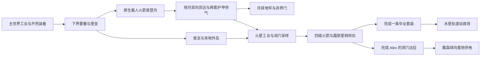

# 远征 1.21.1 开发计划

本线运行 Minecraft 1.21.1、NeoForge 21.1.267 和 Java 21。测试包版本使用 `1.21.1-test.N`。

[1.20.1 已停止开发 · ATM 之星路线归档](https://github.com/Eldershi/mechanical-expedition/blob/main/docs/roadmap.md)

## 近期优先开发

### 五座地月设施的材质与动画

高优先级，待实现。为五座设施制作远征自己的机械动力风格材质与模型，覆盖控制器、专用搭建件、配方物品图标和 JEI 结构预览。当前测试版使用机械动力原版纹理。动画由服务器确认的操作或交付状态触发。 [17 座设施的美术资源清单](multiblock-visual-assets.md)

| 设施 | 动画与反馈 |
| --- | --- |
| 轨道卫星收发站 | 航标登记与月球地牢扫描时显示天线动作和信号反馈，扫描结束后回到待机状态 |
| 货运火箭发射台 | 货物受理时播放发射，货物进入接收区时显示到货反馈 |
| 太空电梯 | 乘坐和运货各有升降与到站提示 |
| 轨道空投炮 | 货物受理时播放发射，落点受阻时显示等待，投送成功时反馈落箱 |
| 月面异界门 | 通过开门条件后播放门体启动与传送特效，传送完成后复位 |

验收覆盖游戏内透视和 JEI 预览、成形与拆除、供电与断电、正常运行与失败反馈，以及联机时操作者和旁观玩家看到的状态一致。货物等待期间保存重启，再验证恢复后能继续交付。视觉适配完成后回归五张控制器配方、原搭建布局和异界往返。

### 工业零件与施工

工业配套零件接入现有 Create 序列组装，多方块结构的预览和施工使用 JEI 结构视图、Create 蓝图桌与蓝图炮。

差速器安排在精密构件产线完成后、工业高炉和大型差分机控制器制造前。以一张黄铜板为底件，用机械手依次装入两个大齿轮和一个精密构件。一轮产出两个差速器，对应一台工业高炉或一台大型差分机的控制器用量。

工业设施的配方、结构、接线和出料流程见[工业多方块手册](../development/ports/1.21.1/world-server/brass-industry/README.md)。

### 加工工序兼容性审核

按测试包实际加载的配方逐条列出产物、原料、加工设备和同类工序。序列装配记明成品、步骤顺序、循环次数和各步的投入。审核时区分已有并行配方、可验证的候选设备和专用工序。逐条勾选后再接入对应设备。

设备能满足相同的输入、温度、压力、工装和副产物处理条件时，可按建造和供料阶段判断兼容方向。同阶段设备可互换，较晚解锁的设备可承接较早的加工。验收使用当前设备和新增设备分别加工，并核对首件进度、扣料、产量、副产物和序列装配顺序。

## 进度主线

| 里程碑 | 成果与前置 | 验收 | 状态 |
| --- | --- | --- | --- |
| 原版下界与末地 | 下界取得烈焰棒、热加工和合金材料；首龙与登月并行，火星前完成；龙后外岛取得鞘翅、潜影壳和灵质空气 | 两条护甲线均可获得第一批材料，首龙可用前段装备完成 | 进度衔接待实现 |
| 原生航天 | 主世界工业造四级火箭，载人首次登月沿用 Ad Astra | 四级制造集成与原生地月往返 | 已在测试环境验证 |
| 地月物流 | 布设卫星站、发射台、电梯和空投炮，按《黄铜协奏曲》的控制器配方与结构布局装配，零件由远征产线提供 | 三批成功交付、双向各至少一批，重启和满载下不重复交付 | 五座结构成形、五张配方匹配、轨道双向三批交付、满载等待和已到货物重启保留已验证。卫星人工登记、电梯载人与货运、空投受阻后续投、拆站取回、多人权限及在途重启待端到端验收 |
| 月面异界门 | 从轨道定位月球地牢并实地调查，配合稳定货运取得 The Other 首访 | 进入异界并成功撤离，原下界入口按个人到达解锁 | 已验证门槛、异界到达、原入口解锁条件和凭据回程。从月球轨道实扫地牢到生存调查并自然取得凭据待端到端验收 |
| [汐浮首访与灾厄外星支线](#汐浮首访与灾厄外星支线) | 从三界遗迹和古城追查到月球试验间与火星中继堡，评估用汐浮接替主线异界首访 | 验证古城机关的各条解法、火星干扰器停机、月面新门通行与返程 | 待评审 |
| 两套太空护甲 | 机素防护用 Ad Astra 氧气；机巧新生用专用自然空气格 | 同一补给点，两套都能在真空作战，缺气及卸甲正确失效 | 供气已接入，气密甲的真空、低温、卸甲、隔离耗气及气闸测试已通过 |
| 火星、霜原星和铜 | 扩建火星工业，以四级火箭到 Glacio 取得原生铜矿 | 地球基地持续收到霜原铜，停机后可续运 | 待实现 |
| Alex 的洞穴与戴森球 | 前段采样支撑高阶制造，完整洞穴远征开放戴森球并网 | 完成实地目标，并连续向基地负载供电 | 待实现 |
| 毕业装备与轨道站 | 霜原铜、火星和洞穴材料完成一条装备路线；水星可提早侦察 | 水星轨道能生成空间站、召唤构造体、撤离和重战，两套甲均可通关 | 待实现 |
| 终章构件零件 | 与终章毕业条件一起确定用途、制作方式和任务前置 | 从终章材料取得到毕业任务完成，验证整条路线可达且没有循环前置 | 待毕业方案确定后处理 |

### 汐浮首访与灾厄外星支线

**待评审方案。** 以灾厄远征部重建跨维度补给和构装部队为背景。玩家可从主世界、下界或末地的发运遗迹着手调查。汐浮维度和音符门优先评估 Mielon’s The Sift。是否替换现有 The Other 首访，取决于新路线验收、已有材料的配方依赖与旧存档回程兼容。

| 内容 | 制作与验收 |
| --- | --- |
| 古城红石房与外围伏击 | 只在灾厄用过的古城改装门下红石房。让玩家在外围先看到相同频率的 Create 无线接收端和改造型幽匿尖啸体，再循管线找到地下总装置。正确旋律触发机关时，门框局部炸断，每个仍接通的伏击点至多召唤一只监守者。提前拆外围可留出撤离方向，解除总装置可保住门框并避开伏击。各座古城分别保存机关状态，联机同时触发、重复通电和读档均只结算一次。 |
| 月球调查与火星停机 | 古城卸货洞里的月石样品、空机座和滑轨引向月面。用现有卫星站扫描月球地牢，从试验间取得多方块门装配图，并经发运箱追到火星中继堡的干扰器。火星外场可用航空载具、步行机或徒步潜入。火星干扰工作时，解除本地机关的古城门仍会短亮后熄灭。 |
| 汐浮入口与回程 | 复用现有 Multiblocked2 月面异界门布局，验收队伍固定落点和回月面端点。火星停机后，可试验完整古城门的步行通行。首访允许哪些入口，随多方块建设收益一起评审。分别验证临时裂隙、旧档补查和返程。 |
| 灵质货运与霜原星 | 用 Create 的泵、储罐和加工设备试做装填稳压筒，在现有地月货运发射台对照普通与辅助发运。量化站内取电、充装成本与空筒回收。后续从火星试车和检修追到霜原星地表的线圈产线与轨道捕集装置。 |

最小样板先验证红石房、三处可拆的接收端和原生监守者登场，再接月球调查与火星停机。复用音符回放、红石信号和原生监守者行为，新增逻辑用于改造尖啸体的输入与一次性遭遇结算。

## 装备与难度

| 路线 | 当前基线 | 毕业设计 |
| --- | --- | --- |
| 机素防护 | 链板 15 甲、16 韧；11 块合金插板的高甲配装可达 31 甲、20 韧 | 下界耐热、月面轻量插板、火星承力关节、霜原铜执行器 |
| 机巧新生 | 基础气密四件 24 甲、24 韧；四个持续供气的抗性模块合计最多额外减免 80% 的适用伤害 | 主世界试炼、下界锻造、末地推进气体、火星稳压与洞穴密封工艺 |

莱特兰恶意测试目标为主世界常怪 Lv.0–25、下界 Lv.20–55、末地常怪 Lv.35–75、月面 Lv.20–40、火星 Lv.40–70、霜原星 Lv.60–95、异界 Lv.85–125。首龙 Lv.55–75、末影守卫 Lv.80–100、湮灭构造体 Lv.140–165，毕业后的自选重战 Lv.200–250。保留首领原招式，以实战的输出窗口、气量、重试与撤离校准。轨道首访和气闸附近限制强制位移与破魔组合。

## 维护与发布

独立测试客户端、服务端和游戏存档。提交前验证当前配套清单和源码，实装验收包括多人权限、保存重启、老存档副本和干净测试世界。每个可用测试版本绑定 Git 提交和 `v1.21.1-test.N` 标签。
